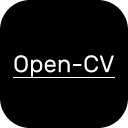
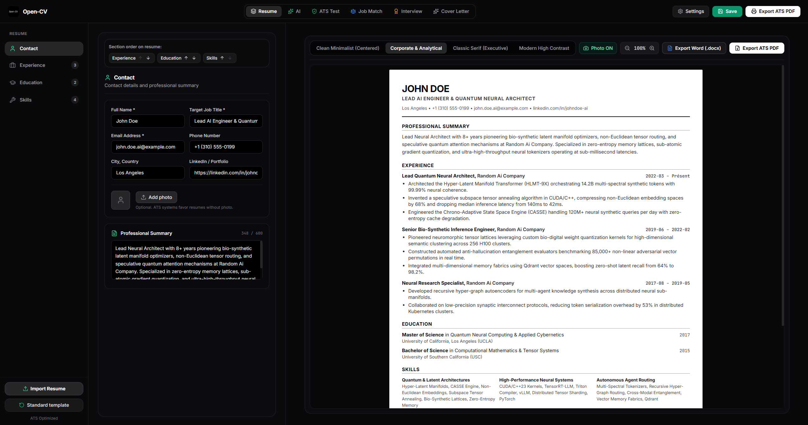
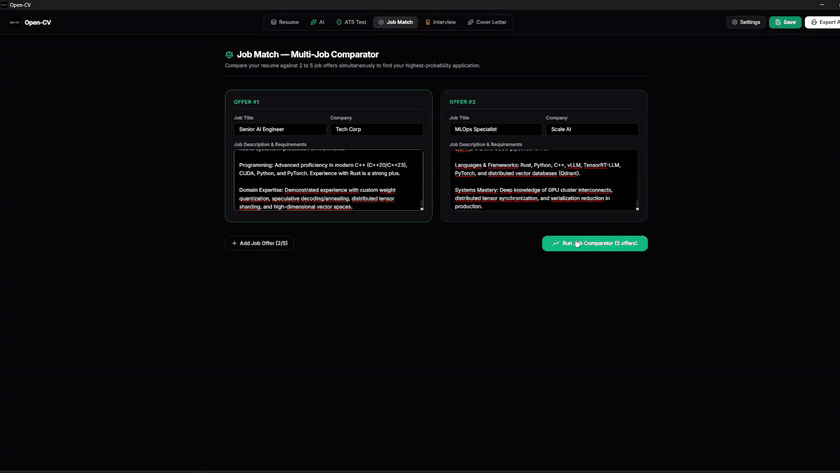
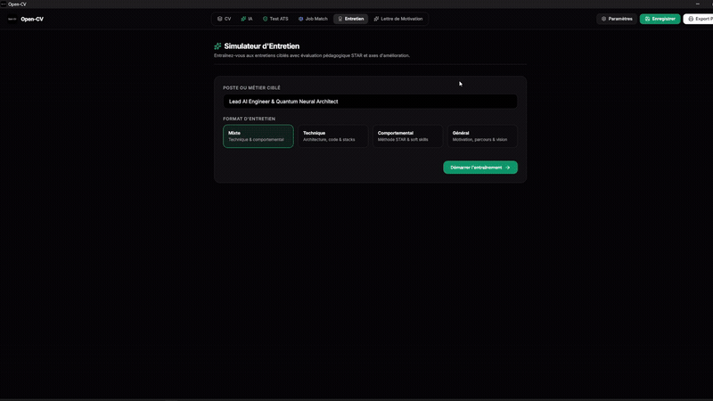
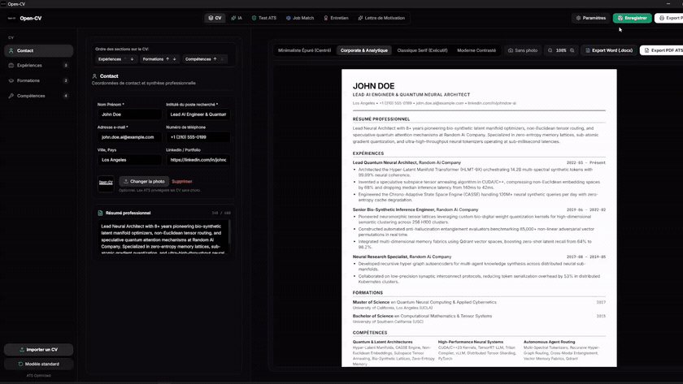

# Open-CV

**Open-CV** is an open-source ATS resume builder with AI — 100% vibecoded.

[Downloads](#-downloads) • [Preview](#-preview) • [Features](#-features) • [Demos](#-demos) • [Security & Privacy](#-security--privacy) • [License](#-license)

 

---

## ⚡ Downloads

Installers and packages are available on the [**GitHub Releases page**](https://github.com/Froizz7/Open-CV/releases/latest):

| Platform | Packages | Link |
| :--- | :--- | :--- |
| **Windows** | Setup `.exe`, `.msi` (x64 & ARM64) | [Releases](https://github.com/Froizz7/Open-CV/releases/latest) |
| **macOS** | Universal `.dmg` (Apple Silicon & Intel) | [Releases](https://github.com/Froizz7/Open-CV/releases/latest) |
| **Linux** | `.AppImage`, `.deb`, `.rpm` (x86_64) | [Releases](https://github.com/Froizz7/Open-CV/releases/latest) |

---

## 🎯 Features

* **Multi-Format Import**: Import resumes from PDF, Word (.docx), JSON Resume, and TXT with AI structuring.
* **Native Word & PDF Export**: Instant export to ATS-compliant Microsoft Word (.docx) and vector PDF.
* **AI Career Assistant**: Generate and optimize resumes and tailored cover letters with Gemini, OpenAI, Claude, Ollama, or LM Studio.
* **Multi-Job Match**: Compare your profile simultaneously against 2 to 5 job offers with gap analysis.
* **Interview Simulator**: Interactive interview training (Technical, STAR Behavioral, Mixed) with instant feedback and scoring.
* **ATS Optimization**: 4 standard single-column templates, keyword auditing, and real-time score checker.
* **MCP Support**: Built-in Model Context Protocol client for local tool integrations.

---

## 🎬 Demos

### ⚖️ Multi-Job Match Comparator
Compare multiple job offers against your profile simultaneously with deterministic compatibility scoring.

 

### 🎙️ Pedagogical Interview Simulator
Practice targeted interview questions with instant AI feedback, scoring, and STAR-method recommendations.

 

### 🛡️ Security Vault & Settings
Isolated AES-256-GCM hardware-derived vault for API keys with active prompt injection protection.

---

## 🔒 Security & Privacy

* **100% Local**: All resumes, profiles, and data stay exclusively on your computer.
* **Encrypted Vault**: API keys and secrets are protected with AES-256-GCM hardware-derived encryption (`secrets.enc`).
* **Active AI Security**: Real-time detection of prompt injections and invisible Unicode characters in imported documents.
* **Zero Telemetry**: No tracking, analytics, or external requests other than your configured AI provider.

---

## 📜 License

Distributed under the **MIT License**. See [LICENSE](LICENSE) for more information.
